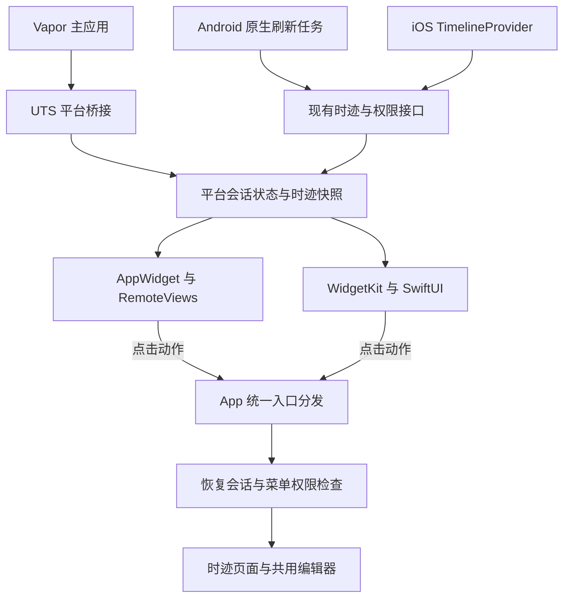

# 小米与 iPhone 桌面小组件接入方案

更新时间：2026-11-12。状态：方案阶段；首版范围为今日时迹，尚未实现原生小组件。

采用 **UTS 插件桥接与平台原生小组件**：Android 使用 Kotlin AppWidget 和 RemoteViews，iPhone 使用 SwiftUI WidgetKit Extension。主应用继续使用 uni-app x Vapor。两端共享业务契约、数据快照语义和跳转动作，分别实现桌面布局、存储、调度与签名打包。

优先交付安装 App 后即可使用的 Android 标准桌面小组件和 iPhone 桌面小组件。小米小部件中心的分发、曝光刷新和审核作为后续阶段，不作为首版完成条件。

## 接入目标与现有基础

| 目标 | 技术路径 | 安装与分发边界 |
| --- | --- | --- |
| 小米手机桌面 | 标准 Android AppWidget | 安装包含组件的 APK 后，从系统原生小组件入口添加；具体入口随桌面版本而异 |
| 小米小部件中心 | AppWidget 加小米专属规范 | 需完成小米适配及应用商店、小部件审核，单纯安装 APK 不等于被中心收录 |
| iPhone 桌面 | WidgetKit Extension | 扩展随 iOS App 安装，使用主应用与扩展匹配的签名和权限配置 |

小米官方明确区分原生 Android 小组件与小米小部件中心：前者无需小米小部件审核，后者须按专属流程提交。[小米上传与审核说明](https://dev.mi.com/xiaomihyperos/documentation/detail?pId=1588)

当前项目可复用的入口：

| 能力 | 当前源码 |
| --- | --- |
| Vapor 与平台声明 | `src/manifest.json`，保留 `uni-app-x.vapor: true` 和样式隔离策略 2 |
| App 工程准备 | `scripts/prepare-app.mjs`，通过 `npm run prepare:app` 复制当前源码到忽略工程 |
| Android 与 Swift 混编样例 | `src/uni_modules/aio-weread-launcher/`、`src/uni_modules/aio-secure-random/` |
| 登录态及请求 | `src/services/session.ts`、`src/services/api.ts` |
| 菜单锁 | `src/services/menu-access.ts`、`src/services/menu-access-cache.ts`、`src/services/secondary-lock.ts` |
| 时迹读取及时间规则 | `src/services/dashboard.ts`、`src/services/time-response.ts`、`src/services/time-format.ts` |
| 独立编辑入口 | `src/pages/time/edit.uvue`，已有 `id`、`date` 参数并复用 `TimeRecordEditor` |

App 工具链沿用当前项目的匹配版本 HBuilderX 5.32 Alpha；编译、签名与历史验证边界见 [App 开发与验证](App开发与验证.md)。现有 UTS 插件不代表 Widget Receiver、iOS Extension 或双端签名链路已经验证。

## 首版今日时迹

### 内容与操作

Android 以 4×2 为目标布局，按桌面实际分配尺寸自适应；iPhone 首版提供 `systemMedium`。小尺寸、大尺寸、锁屏组件、灵动岛、实时活动及其他业务组件留待后续扩展。

| 展示区域 | 内容 | 点击行为 |
| --- | --- | --- |
| 标题 | 今日时迹和必要的日期提示 | 打开 App 当天时迹页 |
| 汇总 | 今日全部记录的总时长 | 打开当天时迹页 |
| 最近记录 | 起止时间、分类路径、标题，最多展示最近一条 | 打开完整记录的详情编辑器 |
| 快捷新增 | 距上次记录时长与加号；无记录时只显示新增图标 | 打开今天的共用新增编辑器 |
| 数据状态 | 必要的更新时间、离线或锁定提示 | 异常时进入 App 处理或重试 |

桌面只承担概览和操作直达，新增、编辑、删除均在 App 内完成。读取完整记录成功后才允许编辑，保留运动明细及阅读、观影关联。首版不增加桌面直接提交、删除或直接修改记录的接口。

App 内仍完整保留时间轴、分类环图和记录列表。桌面视图按系统小组件的尺寸与交互约束提取上述内容，不修改或替代 App 首页。业务和信息优先级以根项目 [今日时迹卡片设计](../../docs/今日时迹卡片设计.md)、[首页功能说明](../../docs/首页功能说明.md)为准；独立克隆时查看[根项目文档目录](https://github.com/lys1313013/aio-life/tree/main/docs)。

### 时间与数据规则

- 今日按设备当前本地日历日计算；请求日期使用 `YYYY-MM-DD`，分钟为从本地零点起的整数，不是 Unix 时间戳。
- `startMinute`、`endMinute` 为闭区间。单条时长为 `endMinute - startMinute + 1`，例如 23:10–23:33 为 24 分钟。
- 今日总时长基于当天完整记录求和，不能只统计桌面可见的最近一条。最近记录按 `startMinute` 倒序选取。
- 待记录时长为 `max(0, 当前分钟 - 最近记录.endMinute - 1)`；无记录时不虚构从零点开始的待记录时长。
- 全部 ID 保留字符串；分钟、总时长、记录数采用整数。原生解析必须拒绝数字字符串冒充计数、无效分钟和不完整的单日列表。
- 跨日、时区及系统时间变化后重新核对日期。旧日期快照不能套用为新一天的总时长，也不能把“尚未查询今天”显示成“今天无记录”。

固定的闭区间、无记录、全天已满和跨日样例应成为后续 TS、Kotlin、Swift 共用的模拟数据，确保三个实现的计算结果一致。

### 展示状态

| 状态 | 桌面行为 |
| --- | --- |
| 首次读取 | 使用与最终布局接近的占位，不显示虚构统计 |
| 已有内容刷新 | 保留快照及占用空间，更新提示不挤动布局 |
| 今日无记录 | 明确空态并保留新增入口 |
| 网络失败 | 同日且权限仍有效时保留旧快照，标明更新时间；无可用快照则显示失败状态 |
| 未登录或登录失效 | 隐藏业务内容，提示进入 App 登录 |
| 菜单锁定或权限无法确认 | 隐藏业务明细，进入 App 处理；不沿用旧快照展示锁定内容 |
| 跨日但新数据未到 | 标明尚未更新或展示占位，不显示昨天的记录为今天的数据 |

## 双端架构与职责

App 查询或修改时迹成功后，经桥接更新快照并请求系统刷新。App 不运行时，由平台任务在系统允许的执行窗口读取接口。组件不得为刷新启动 Vapor 页面或依赖页面内定时器。

UTS 插件的原生代码不能直接导入项目外部业务源码。业务侧负责组装展示快照；原生后台读取采用同一书面契约及模拟样例，避免把插件与 App 内部模块相互引用。DCloud 支持插件内混编 Kotlin、Swift，以及 Android 原生清单和资源配置。[UTS 原生混编](https://doc.dcloud.net.cn/uni-app-x/plugin/uts-plugin-hybrid.html)、[UTS 插件配置](https://doc.dcloud.net.cn/uni-app-x/plugin/uts-plugin.html)

## 接口与快照契约

### 首版复用接口

| 接口 | 用途 |
| --- | --- |
| `GET /timeTrackerCategory/list` | 分类路径、颜色 |
| `GET /timeRecord/query?date=YYYY-MM-DD` | 指定日期的完整时迹，计算总时长与最近记录 |
| `GET /auth/secondary-lock/menus` | 检查菜单锁配置 |
| `GET /menu/all?client=mobile` | 有锁定菜单时解析时迹及父级菜单的锁定关系 |

沿用 `{ code: 0, message: null, data: ... }`、整数业务码和 Bearer Token，错误信息字段为 `message`。原生解析对齐 `contract.ts` 与 `time-response.ts` 的当前契约，不另起旧格式兼容分支。详情编辑继续由现有业务服务加载完整数据。

默认复用接口，不新增后端表。如果原生联调发现现有权限接口不能可靠判断桌面展示权限，应先解决服务端契约，再开放相关内容；不能通过“持有有效 Token”绕过菜单锁。实际需要数据库变更时，提供已有库可执行的增量脚本，并同步实体和调用方，不顺手修改全量初始化 SQL。

### 展示快照

以下为待实现的数据契约，不是现有接口或已落地存储格式。

| 字段 | 含义 |
| --- | --- |
| `accountKey`、`sessionGeneration` | 本地账号标识及会话代次；不使用 Token 作为展示或日志字段 |
| `date`、`timeZoneId` | 业务日期及生成快照时的设备时区 |
| `fetchedAt`、`requestRevision` | 成功读取时间及请求顺序，用于时效展示和拒绝旧响应 |
| `displayState` | `loading`、`ready`、`empty`、`error`、`signedOut`、`locked` 等业务状态 |
| `accessCheckedAt`、`accessExpiresAt` | 桌面展示权限的检查时间与本地有效边界；不是延长服务端解锁 |
| `totalMinutes`、`recordCount` | 完整单日数据计算出的整数汇总，未成功读取时不可伪造为 0 |
| `latestRecord` | 可空；只保留展示所需的字符串 ID、起止分钟、分类路径、标题及颜色 |
| `lastEndMinute` | 最近记录的结束分钟；无记录时为空，用于待记录时长计算 |

快照与凭据分开存放。只持久化桌面需要的最小内容，不复制整份首页状态、附件或关联记录详情。按组件实例记录绑定账号和类型，同账号同日期的多个组件共用一次读取。切换账号后旧组件清空并等待在 App 中重新确认绑定，不自动展示新账号的数据。

后台请求提交结果前，原子核对账号、会话代次、日期、权限状态和请求顺序；较早的请求不能覆盖较新的结果。退出登录、关闭桌面展示或切换账号时先使会话代次失效，再取消任务、清除快照和凭据，最后请求系统重新绘制。

## 登录与桌面展示权限

登录、恢复会话、退出和失效清理统一接入 `session.ts` 的生命周期，不由业务页面各自同步 Token。首次启用时明确桌面可见范围；首版只开放今日时迹，保留关闭展示和清除共享数据的入口。

Android 使用 Keystore 保护的应用私有凭据存储，通过非导出的 `ContentProvider` 统一管理跨进程状态，避免直接读取 DCloud 内部存储实现或用普通多进程 SharedPreferences 维持一致性。iOS 将凭据放在配置好访问组的 Keychain，App Group 共享容器只存快照及必要配置。[App Groups](https://developer.apple.com/documentation/xcode/configuring-app-groups)、[Keychain 共享](https://developer.apple.com/documentation/xcode/configuring-keychain-sharing)

桌面展示不能继承前台临时二级解锁。时迹或父级菜单被配置为加锁时，组件显示锁定状态，不导出标题和记录明细；后台不得发起解锁弹窗，也不自动保存或提交二级密码。App 内修改锁配置后立即使桌面权限快照失效；后台每轮读取前核对权限，失败或有效期到期时隐藏业务内容。具体有效期在原生验证阶段结合刷新能力确定，不直接复用 App 内菜单配置的 12 小时缓存期限。

遇到 HTTP 401、当前契约的会话失效或 `code: 2001` 二级锁要求时，停止相应读取并切换状态。菜单配置仍加锁时，前台临时解锁不改变组件的锁定状态；解除菜单加锁配置并重新确认桌面展示后才恢复内容。远端权限变更及 iOS 桌面重绘可能延迟，因此桌面不是实时撤回界面；首版不展示描述、附件等更多敏感信息，不能承诺退出后系统缓存的画面立即消失。

## 刷新与时间显示

### 共同行为

| 触发条件 | 动作 |
| --- | --- |
| 首次添加组件 | 渲染权限允许的本地快照，调度一次读取；没有会话则保持未登录状态 |
| App 查询今日时迹成功 | 写入同日新快照并请求刷新 |
| App 保存或删除记录成功 | 使受影响日期失效；涉及今天时重算快照，保留其他组件的状态 |
| App 从后台恢复 | 核对日期、时区、账号及权限，到期时合并刷新 |
| 系统后台调度 | 原生执行权限与业务读取，不依赖 App 页面定时器 |
| 请求失败 | 区分网络错误与权限错误，不把错误转换成空记录 |
| 所有组件移除或桌面展示关闭 | 停止该组件的专属任务并清理不再需要的状态 |

App 内仍使用 `src/services/api.ts` 的统一策略：GET 遇网络失败、超时或 5xx 最多重试 3 次，共 4 次，间隔 300/600/1200ms；非 GET、4xx、业务错误和取消不做故障重试。桥接层不再叠加一轮。

原生后台不能直接执行该 TS 请求器，应对齐错误分类与每轮重试上限，并受平台任务执行窗口约束。可用时间不足时结束本轮、等待后续调度，不在广播接收器内阻塞完成多轮请求；不得再叠加调度器的无界重试。账号、日期或权限变化后旧请求及后续重试立即失效。

### Android 与小米

标准 Android 的 `updatePeriodMillis` 不支持小于 30 分钟的周期。WorkManager 的周期下限为 15 分钟且可能受省电限制，不能据此承诺准时刷新。首版按 30 分钟级尽力更新，加上 App 操作后的主动更新；初次验证优先评估 `JobScheduler + JobService`，让后台读取能够运行在组件进程内。[Android 刷新机制](https://developer.android.com/develop/ui/views/appwidgets/advanced)、[周期任务限制](https://developer.android.google.cn/reference/androidx/work/PeriodicWorkRequest)、[JobService](https://developer.android.com/reference/android/app/job/JobService)

待记录时长首版显示截至快照更新时间的结果，并配合结束时刻或更新时间提示。只有在系统计时控件能够精确满足闭区间分钟、跨日和未来时间约束时才启用动态时间文字；不通过常驻服务、秒级轮询或精确闹钟维持桌面时钟。

### iPhone

WidgetKit 使用 Timeline 驱动显示，TimelineProvider 在系统允许时读取共享快照及服务端数据。App 写入成功后调用 `WidgetCenter` 请求重新加载，不代表系统立即重绘。首版以约 30 分钟后的时间作为请求下一次读取的建议点，系统可推迟或合并；时间线预置跨日本地占位，避免继续显示前一天的“今日”数据。

系统动态日期文字可以独立于业务请求更新，但须先验证显示是否满足闭区间的按分钟规则；不满足时显示“截至更新时间”的时长。不得靠每分钟生成大量 Timeline 条目模拟接口刷新。Apple 明确说明刷新受动态预算管理，TimelineProvider 不是持续运行的后台服务。[WidgetKit 更新机制](https://developer.apple.com/documentation/widgetkit/keeping-a-widget-up-to-date)

首版不引入推送刷新或实时活动。其他客户端修改数据后，桌面在下一次允许的读取中同步；不能承诺分钟级跨端一致。

## Android 与小米接入

首版创建标准 AppWidgetProvider，Manifest 注册 Receiver 和组件元数据，插件 `res` 提供布局、预览图及配置。使用 RemoteViews 绘制必要文字和操作，减少依赖；不搬入页面运行时或整套图标目录。[Android 小组件](https://developer.android.com/develop/ui/views/appwidgets/overview)

组件及后台读取尽量按 `:widgetProvider` 进程组织。初次 APK 验证必须测量该进程是否意外初始化 Vapor 引擎、是否依赖主进程，以及资源和 Receiver 是否被打包或裁剪。进程名本身不能证明内存隔离达标。

通过 `PendingIntent.getActivity()` 打开 App 统一分发入口；根据 Android 版本设置明确的可变性标记，并为不同组件和动作提供独立身份，防止点击目标互相覆盖。App 内“添加到桌面”仅在宿主支持时发起固定组件请求，由用户确认；不支持时提供系统添加指引，不报告为已添加。

后续接入小米小部件中心时，共用数据和渲染能力，标准 Provider 与小米专属 Provider 的元数据、刷新配置分开维护，避免出现两个无法区分的重复入口。小米规范涉及 `:widgetProvider` 独立进程、35 MB 内存限制、不因刷新拉起主进程、`miuiWidget` 标识、曝光刷新、版本号和背景裁切；这些约束均需实际 APK 验证。[小米技术规范](https://dev.mi.com/xiaomihyperos/documentation/detail?pId=1584)

小米专属小部件会去掉原有定时刷新，需按曝光广播及节流机制接入，不能直接套用标准 Provider 的周期策略。启用前还需完成尺寸、预览图和无障碍检查，按当前开发者平台流程提交应用及小部件；正式收录状态单独记录。

## iPhone 接入

使用 Xcode 维护 SwiftUI Widget Extension 工程，首版只声明中尺寸桌面组件。主应用与扩展是独立进程；扩展不加载 Vapor 页面，不能依赖主应用的 `uni` 存储或页面生命周期。[创建 Widget Extension](https://developer.apple.com/documentation/widgetkit/creating-a-widget-extension)

主应用及扩展需配置同一开发团队和 App Group，扩展拥有独立 Bundle ID 与描述文件；共享能力的签名权限对应一致，各自的应用标识与自身 Bundle ID 匹配。快照文件采用原子替换并携带会话代次，会话失效和快照提交通过原生跨进程锁串行处理，写入者在锁内重新核对代次，避免 App 与扩展并发写入复活旧账号数据。设备锁定时凭据不可读，应显示受限状态而不是降低保护等级。

DCloud 的 iOS Extension 集成方式是：在 Xcode 中编译、导出包含扩展的发行包，提取 `.appex` 后放入 UTS 插件 `app-ios/Plugins/`，配合 `ios-extension.json` 配置扩展标识、描述文件及所需权限。插件内写 Swift 桥接不等于自动生成 Widget Extension。[DCloud iOS Extension](https://uniapp.dcloud.net.cn/plugin/uts-plugin.html#iosextension)

扩展源码和可复现的构建说明进入 Git；编译后的 `.appex`、IPA、描述文件、证书与真实标识保留在忽略目录或构建环境。后续打包脚本在忽略的 App 工程内注入扩展与签名配置，不能将真实值写回 `src/manifest.json` 或示例配置。

当前 `prepare:app` 只准备主应用工程，不包含上述扩展构建、注入和签名流程。首个技术验证必须用当前 HBuilderX 验证主包嵌入、最终 entitlements、扩展安装发现及 App Group 读写；若云打包无法保留这些配置，再评估官方支持的离线打包能力与成本，不能直接宣布已支持生产分发。

## 点击分发与视觉复用

### 点击动作

| 待实现动作 | 当前业务落点 |
| --- | --- |
| `openTimeDay(date)` | 时迹 tab 页 `src/pages/time/index.uvue`；待补齐日期消费，不能假定 `switchTab` 支持查询参数 |
| `createTimeRecord(date)` | 独立编辑路由 `src/pages/time/edit.uvue` 的 `date` 参数 |
| `openTimeRecord(recordId)` | 同一编辑路由的 `id` 参数，重新查询完整记录 |

Android Activity 与 iOS URL 入口统一映射到白名单动作，不执行外部传入的任意页面路径。URI 只携带动作、日期和字符串 ID，不包含 Token 或正文。冷启动等待运行时、登录态及导航就绪后再分发；App 已运行时处理新的点击，消费后清除动作以免恢复前台重复打开。

分发顺序为恢复会话、必要的登录、菜单权限检查、打开业务入口。点击新增时以实际打开编辑器时的本地今天为准；如果点击来自跨日旧快照，重新读取今天的推荐时段。点击最近记录按 ID 查询，记录已删除时显示明确状态。登录或解锁取消后不自动提交或继续打开过期动作。

### 主题与排版

原生组件按宿主的系统深浅色和平台外观渲染，同时保留 AIO 的颜色与信息层级；App 单独设置的主题不强制覆盖系统桌面外观。iOS 的系统着色外观、Android 的桌面缩放均需实际检查。

颜色从 `src/theme.json` 生成原生资源，间距从 `src/styles/spacing.json`、排版从 `src/styles/typography.json` 映射到 Android 和 Swift 资源。后续增加生成步骤而不手写另一套业务字号、字重、行高和普通间距数值；平台尺寸、安全区及至少 44px 点击区等几何约束单独注明。原生字号单位适配系统字体缩放和 Dynamic Type，不能按固定像素截图锁死布局。

长标题和分类路径按容量截断，提供完整可访问名称；可表达的操作优先使用图标，不重复堆叠文字。保留 loading、禁用、焦点与选中状态，不为按钮增加业务自定义按下缩放或透明度效果。

## 后续源码归属

以下均为计划位置，本阶段不创建实现文件。

| 计划位置 | 职责 |
| --- | --- |
| `src/uni_modules/aio-desktop-widget/` | UTS 接口、Android Kotlin 与资源、iOS Swift 桥接 |
| `src/pages/time/services/desktop-widget.ts` | 今日时迹快照组装、业务失效与同步入口 |
| `src/services/native-desktop-widget.ts` | 仅平台能力、会话同步和白名单动作桥接；不聚合分包业务 |
| `native/ios/AioLifeWidgets/` | Widget Extension 的 Xcode 工程、SwiftUI 源码和无凭据配置说明 |
| `scripts/prepare-app.mjs` 及配套脚本 | 原生资源生成、忽略工程的扩展注入与本地配置读取 |
| `tests/` 与原生工程测试目录 | 模拟契约、生命周期、跳转及原生刷新回归 |

业务专属逻辑保留在时迹分包，主包只处理必要的通用桥接；H5、微信及非目标平台通过条件编译隔离。不为桌面组件引入主包可达的 Android/iOS 资源，不修改 Vapor 或削弱既有包体检查。新增桥接若影响微信引用链，实施时执行最终代码的包体检查。

## 实施阶段与验收

| 阶段 | 交付内容 | 通过条件 |
| --- | --- | --- |
| 原生链路验证 | 双端静态今日时迹组件与模拟共享数据 | 小米 APK 可添加并点击；iPhone 签名包内扩展可发现并读取 App Group；确认独立进程与打包行为 |
| 首版业务接入 | 今日汇总、最近记录、新增入口、会话与权限同步、后台读取 | 双端用模拟数据完成展示、跳转、失败恢复、跨日及账号隔离；App 不运行时仍能按系统允许的时机读取 |
| 双端真机验收 | 最终签名安装包 | 小米和 iPhone 分别完成下列验收，记录系统、桌面、工具链版本及实际结果 |
| 小米中心扩展 | 小米专属 Provider、曝光刷新与分发材料 | 技术规范与审核分别完成；中心收录与正式发布状态单独记录 |

首版验收至少覆盖：

- 数据：空、单条、多条、超过五条、长标题和深层分类；汇总基于全量记录；闭区间、00:00、23:59、全天已满、未来结束分钟均正确。
- 状态：首次延迟读取、空态、失败重试、已有内容刷新不跳动；401、二级锁、权限未知和无网络分别处理，不误展示为 0 或空记录。
- 并发：切换账号、关闭展示、退出与旧响应交错；同日并发读取、跨日旧请求；多实例不串账号、不重复请求。
- 时间：本地午夜、时区及系统时间变化；午夜之后、后台长时间停留后的点击新增使用今天；时间文字更新与接口更新分别观测。
- 操作：冷启动、前台与后台点击，登录或解锁取消，重复点击，目标记录被删除；详情失败不允许提交，编辑保留全部附属字段。
- 原生生命周期：普通进程回收、用户强制停止、重启、清除应用数据、覆盖安装和移除所有组件分别测试；系统不允许执行时如实显示时效，不以强行保活补偿。
- 视觉：小米不同桌面网格与缩放、iPhone 中尺寸、双端深浅色、字体放大、长文本和无障碍；返回 App 的编辑器仍检查手机、平板、桌面深浅主题。
- 打包：Android 最终 Manifest、原生资源、Receiver 与后台进程内存；iOS `.appex` 嵌入、Bundle ID、描述文件、App Group、Keychain 和最终签名权限。

进入界面实现前，从运行中的 Web 菜单检查今日时迹、详情、编辑与删除确认，记录可保留的信息层级和移动差异。每阶段分别记录“实际 Web 已查、Mobile 已改、Mobile 已看图、交互已验证、阻塞项”，不能用本文的方案描述替代验收。

准备提交实现代码时按 [README](../README.md) 执行最终改动的统一验证，原生相关变更另做匹配工具链编译与安装包验收。H5 模拟接口、微信编译、Android/iOS 原生编译、小米/iPhone 真机、上传、体验分发、审核和正式发布分别记录；编译通过不代表后续状态完成。

本阶段仅整理方案和文档入口，不新增插件、依赖、接口、数据库迁移或原生工程，不进行打包、上传和发布。纯文档变更只检查差异；未运行测试，留待提交前统一验证。
